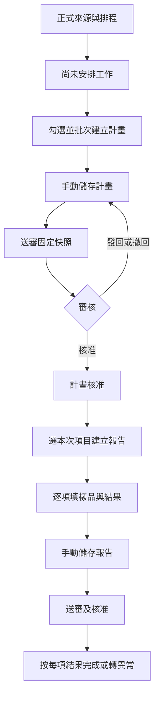
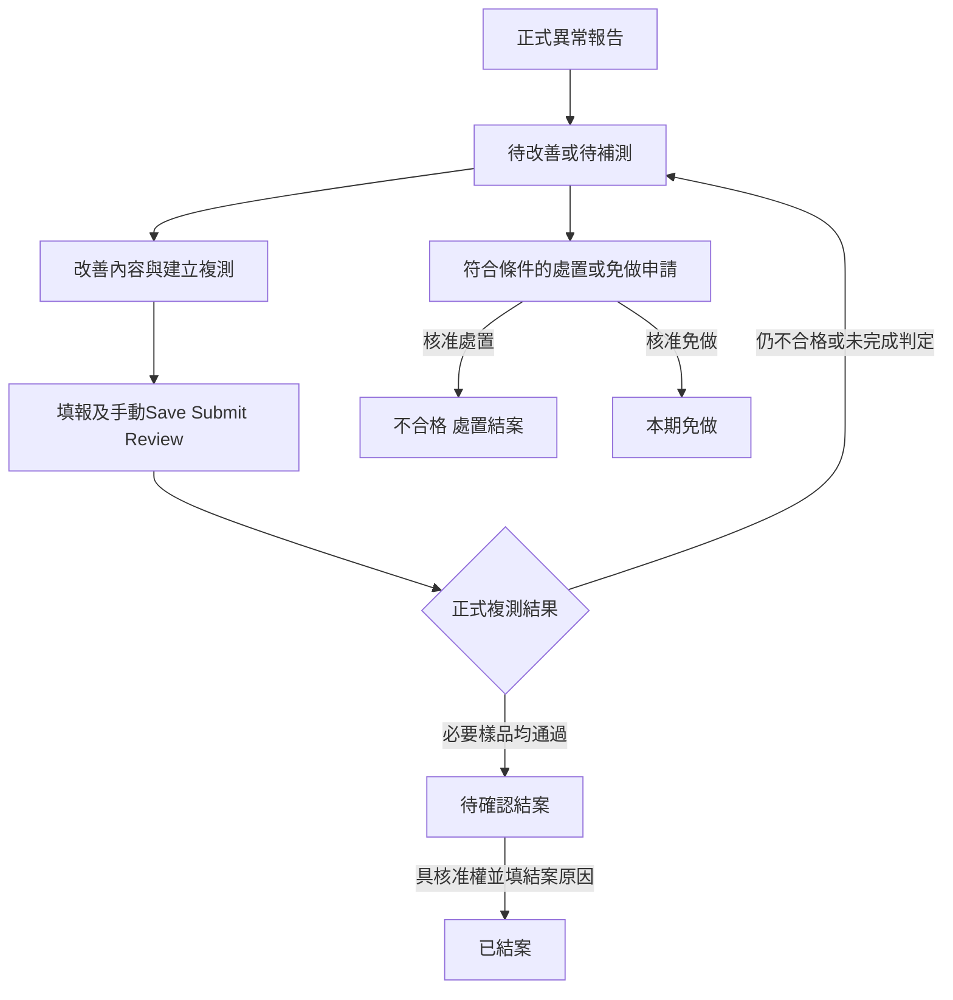

# FQC整體設計 審核條件與其他例行模組接續指南

Deprecated 歷史保存版。最新整合討論版請使用 [FQC設計與審核條件_20261013.md](FQC設計與審核條件_20261013.md)；本檔10/8的跨列重測與舊權限文字不作當前規則，原歷史ZIP保留。

保存版提示：本檔為2026-10-08歷史快照。樣品及再測按鈕規則已由[2026-10-12最新回饋](../specs/current/ROUTINE_FQC.md#2026年10月12日單樣品與複測回饋)取代；供IQC續談時不要套用舊跨列重測介面。原ZIP保留不改。

保存日期：2026年10月8日。用途：保留目前FQC的設計與條件，供後續討論IQC、模具檢查、檢具與測試設備校準時沿用。

**建議保留FQC的共用骨架，分別補上其他模組的檢查對象、排程和判定規則。** 四個入口可共用清單、計畫、報告、固定送審、異常追蹤及歷史；各自的檢查標準、完成條件和審核政策要獨立。這份保存版可上傳給ChatGPT；後續正式需求仍以專案的現行規格為準。

## 目前可延續的範圍

| 層次 | 目前狀態 | 後續用途 |
| --- | --- | --- |
| 例行檢查下的FQC | 已有排程、工作、計畫、初測／複測報告、免做、處置、審核及歷史實作 | 共用流程的現有基礎 |
| 例行檢查下的IQC、模具檢查、檢具與測試設備校準 | 入口及審核分類存在，執行功能仍顯示建置中 | 後續擴充；不能當作已完成功能 |
| 資料後台的FQC、IQC、模具設備、品質設備 | 各自有主檔、標準與既有版本規則 | 例行工作的來源；保留既有資料和穩定身分 |
| 最新原樣品多次測試 | 後端及介面隔離測試已通過；選樣後即時啟用按鈕的最後畫面驗證尚未完成 | 保存最新規則，不能寫成完整端到端驗收已結案 |

例行執行與主檔管理是不同層：修改檢查標準須走主檔版本流程；一份計畫或報告保存建立當時的來源快照，主檔之後改名、停用或改版不回寫舊文件。

## 頁面整體配置

上方保留FQC、IQC、模具檢查、檢具與測試設備校準四個入口。每個已實作模組使用相同閱讀顺序：

| 區域 | 用途與操作 |
| --- | --- |
| 排程設定 | 先預覽再設定管理起始日；有文件後不能重算既有期別 |
| 應檢清單 | 找尚未安排工作，跨篩選勾選，批次建立同一份計畫 |
| 檢查計畫 | 草稿、待審、核准待建報告、已建立報告及歷史分組 |
| 報告與申請 | 初測報告RPT、複測／更正RPT、免做WVR、處置DSP各自分框 |
| 異常追蹤 | 待改善、複測中、待確認結案、已結案、處置結案、本期免做分框 |
| 搜尋與歷史 | 查來源快照、產品／樣品、編號、期別、結果、審核與所有歷次文件 |

桌機左側清單、右側完整明細。左清單上方放進度快捷和分類定位按鈕，各自附數量；點分類只捲動清單內的相應框，保留右側文件。已選列用藍色與「正在查看」編號表明目前文件，不能只靠顏色。

手機單欄清單與明細，進入／返回保留位置和輸入。長標準、照片及歷史可展開；主要確認與取消按鈕須看得見、可鍵盤操作、可觸控。固定標題和選項切換中越文；使用者填入的越文、產品名稱及原始標準不自動翻譯或重寫。

報錯用紅色，待補資料用黃色，操作紀錄用藍色。文稿版本卡可收折詳細紀錄，儲存、送審、撤回與捨棄保留清楚入口。

## 統計和清單狀態

| 名稱 | 目前判斷 | 不代表什麼 |
| --- | --- | --- |
| 尚待完成 | 工作尚無completion完成紀錄 | 不等於所有未結案異常 |
| 待審核 | 未取消文件存在固定pending案件 | 不包含尚未送審草稿 |
| 異常未結案 | 案件尚非closed、disposed、waived | 報告核准仍可能在此數量中 |
| 已逾期 | 截止日早於公司當日，且工作尚未完成 | 截止日當天不算；已完成但異常未結案另計 |

統計卡及不合格快捷以同色底線、底色和文字標記符合的項目，其他列保留，再點取消。產品、線別、類別、項目及日期搜尋仍有效，可見標記數因此可能少於全域統計。分類定位和進度篩選是另外兩種操作，不能混成同一意思。

工作、文件與異常有三套獨立狀態：
- **工作完成**：這個項目在本期已有依規則完成的檢查或核准終止處理。
- **文件審核完成**：該份計畫、報告或申請正式留存。
- **異常結案**：不合格／未完成判定已經正式閉環。

例如正式不合格報告可能讓本期「檢查已完成」，但異常仍待改善；不能顯示成產品合格。

核准計畫必須明示「尚未建立報告」「部分報告尚待建立」或「已建立報告」。仍可填報時顯示「需要建立報告」，已有報告時顯示編號入口，優先接續同系譜草稿或待審文件；沒有可填報項目的歷史計畫要說明原因。

## 檢查對象和資料關係

FQC按**檢查項目加期別**產生一筆工作，不把涵蓋的每個產品拆成一份工作。

例：尺寸檢查涵蓋甲、乙、丙，本月只有一筆應檢工作。本次測甲，報告同時標「涵蓋甲乙丙」與「實測甲」。搜尋乙也能找到該標準的報告，但不能宣稱乙已量測合格。

| 資料 | 責任與關係 |
| --- | --- |
| Source來源快照 | 標準與版本、項目身分、線別／類別／錯誤碼、說明、涵蓋產品 |
| Job應檢工作 | 項目身分、起日、截止日、來源快照、目前計畫及完成紀錄 |
| Plan檢查計畫 | 可含多個工作；建立即占用所選工作，核准後可建執行報告 |
| Report檢查報告 | 屬於計畫，可部分填報；初測和每次複測各有獨立編號 |
| Line檢查項目列 | 關聯Job與Source；複測另固定必要原樣品 |
| ResultRow結果列 | 獨立ID、實測樣品、判定、實際值、問題說明、照片 |
| Case異常案件 | 關聯原工作、初測及全部複測、必要樣品、改善與事件 |
| Waiver與Disposal | 各自為須審核的免做／處置文件，不改成合格 |
| SharedDraft共用文稿 | 每份文件有working、手動saved、固定pending案件、正式active及歷史 |

目前沿用D1與R2既有儲存、專用FQC控制與API；沒有新增SQL表或migration。其他三模組的共用引擎尚未抽出，不能把建議中的架構描述成目前已存在。

## 排程條件

只有正式生效、啟用且能解析時間頻率的FQC項目納入排程。主檔已有有效時間頻率，不需在例行頁再勾一次「納入」。未知或自訂頻率先列待確認，不猜日期或數量。

| 頻率 | 公司曆期 |
| --- | --- |
| 每週 | 星期一至星期日 |
| 每月 | 每月1日至月底 |
| 每季 | 1至3月、4至6月、7至9月、10至12月 |
| 每半年 | 1至6月、7至12月 |
| 每年 | 1月1日至12月31日 |

公司日期按Asia/Ho_Chi_Minh，UTC加7，與Asia/Bangkok同日界線。從管理起始日與正式生效日較晚者所在的當期開始，不追造更早期工作；未來起日未到不提前產生。

有既有工作時，頻率變更從最後截止日次日接續，不刪舊工作、不留空窗或重疊。第一段可能是較短的過渡期，之後對齊曆期。例如月期到10月31日，改週期後11月1日為過渡段，下一週再按星期一開始。

開頁／同步檢查日期及來源變更時，依正常Generate流程補齊截至公司當日的工作；關頁或停機後下次再補，不保證電腦關機時持續執行。重試或多人開頁不重複產生相同期別工作。

## 從計畫到正式報告

建計畫需有編輯權限，所選工作不能已安排或完成。伺服器核對工作占用與revision，不能只依畫面的勾選框判斷。

建執行報告需計畫已核准，項目確實屬於該計畫且仍由該計畫家族占用。允許同一計畫分次選項目填報，但同項初測不能重複建立；已有草稿或文件時接續原文件。初測防重複不影響異常案件建立獨立複測報告。

## 儲存與審核條件

**同步不等於儲存；儲存不等於送審；送審不等於核准。**

| 動作 | 條件與結果 |
| --- | --- |
| 修改與同步 | 只在可編輯草稿、具權限且無待審鎖時進行；保留欄位guard及並行衝突檢查 |
| 儲存草稿Save | 固定整份目前工作內容；業務缺漏可先存，但非法格式、引用、來源快照改寫及衝突不能寫入 |
| 送審Submit | 必須已有成功手動Save；savedId與目前保存快照一致；驗證整份saved內容後建立固定案件 |
| 核准Approve | 具審核權限、指定案件仍待審、正式基底未變；重新核對驗證，核准固定案件內容 |
| 發回Return | 具發回權限、固定案件仍待審；填修改意見，保留原送審快照 |
| 撤回Withdraw | 具撤回權限、原案仍待審；回到可編輯流程，保存及審核歷史保留 |
| 正式文件 | 唯讀；不能用修改草稿的API覆寫原正式版 |
| 更正與復原 | 沿既有受控流程、確認相依與目前占用；不是刪掉原版重建 |

搜尋、分頁或分類只改檢視，不縮小Save及Submit範圍。Save後再輸入而沒有重新Save，Submit仍使用上次手動Save的內容；不能默默代存新輸入。

FQC的Submit、Withdraw、Approve不要求額外操作理由；業務欄位必要說明仍要填，Return仍要修改意見，確認異常結案仍要原因。這是FQC專用政策，不自動套到其他主檔或未實作模組。

具核准權的ADMIN可明確確認自送自審並留紀錄；FQC目前禁止一般帳號自審，也不為一般帳號新增核准權。部分其他模組的共同政策與FQC實作不同，後續討論要逐模組決定，不能直接放寬共同核心。

## 每種結果的送審必要內容

所有文件先有非空文件名稱、有效日期及至少一項目。檢查報告逐結果列驗證，任一列缺必要內容即阻擋整份送審。

| 結果 | 實測樣品 | 實際值 | 問題說明或原因 | 成功上傳照片 | 核准後 |
| --- | --- | --- | --- | --- | --- |
| 合格 | 必填 | 必填 | 選填 | 選填 | 該項可完成；不把未測涵蓋產品標為合格 |
| 不合格 | 必填 | 可填 | 必填 | 至少一張 | 正式留存，進入改善追蹤；沒有未測／未判定列時該期檢查可完成 |
| 無法測試 | 必須空白 | 可填 | 必填 | 選填 | 檢查未完成，建立補測安排或申請本期免做 |
| 已測但無法判定 | 必填 | 可填 | 必填 | 至少一張 | 檢查未完成，補充判定或複測 |

缺必要資料可儲存草稿，不可送審。畫面標在「待補資料」不代表可送審，FQC後端仍把這些缺漏視為阻擋。

照片必須成功上傳並存在於授權儲存；檔名、失敗的上傳或偽造photoId不算證據。目前支援JPEG、PNG、WebP、GIF，單張上限25MB，檢查類型、簽名、登入、來源及權限。

免做申請另需原因。處置申請另需原因、處置內容及成功上傳的證據；兩者核准後保留獨立文件，免做不等於合格，處置仍保留不合格。

## 原樣品與重複測試

樣品從該項目來源快照的涵蓋產品中選，不跨項目。**不同結果列可以測試同一樣品多次**，每次各自有判定、值、說明與照片；同一列的樣品仍不可重複。每個項目最多100列，每列ID必須獨立。

「以此樣品再測一次」在當前草稿新增同樣品的空白列，不複製合格／不合格、實測值、原因或照片，也不自動Save或Submit。未選樣品時按鈕停用；無法測試列不能以虛構樣品再測。

第一次正式報告及樣品不改寫，複測文件固定建立當時的必要原樣品。正常已測的複測需涵蓋上次未通過樣品。若本次確實無法測試，可填完整原因送審留存，仍保留未測義務，不能當驗證合格。

同一份報告同樣品出現不合格與合格，仍保留不合格；列的順序不會讓後列合格覆蓋失敗。合格與無法判定混合也不解除前次失敗。後續獨立報告對必要樣品的各次均合格，才解除該樣品的未解決失敗，之後仍需確認結案。

例：原報告樣品甲失敗。第一次複測有甲合格和甲失敗，仍待改善；第二份複測甲各次都合格，案件才能待確認結案。所有舊失敗與照片仍可回查。

## 異常處理與結案條件

| 操作 | 條件 |
| --- | --- |
| 改善並建立複測 | 非終止案件；具編輯權限；沒有同案後續草稿／待審文件；不合格需本次改善內容或本次失敗之後已記錄的改善 |
| 合併改善與複測 | 一個入口輸入改善內容，同次CAS記錄改善及建立文件；取消不寫入，重試不重複 |
| 無法測試後續 | 先建補測計畫，計畫核准後再建報告；不能跳過需核准的安排 |
| 再次不合格 | 可依完整內容正常Save／Submit／核准，繼續新改善和下次複測，不要求改選合格 |
| 確認結案 | 案件已ready-close、具approve權限、revision一致、填結案原因 |
| 申請本期免做 | 目前為unable，且沒有未解決的原不合格；不能以免做消除失敗 |
| 申請處置結案 | 當前不合格或仍有未解決的原不合格；填原因、處置及證據後走核准 |
| 已結案、處置或免做 | 不新增一般後續；更正依既有受控流程，保留原事件 |

同一案件已有後續草稿就開啟原文件，不另建。尚未送審的複測草稿可確認收回，沿可復原捨棄流程；待審文件先撤回，正式文件不可當草稿收回。

新一期工作照常產生，但新期合格不自動關閉舊期異常。舊案保留自己的期別、改善、報告與結案條件。

## 權限和防止錯誤寫入

權限由伺服器判定，隱藏或停用按鈕不是授權本身。目前FQC的映射：

| 能力 | 現行權限條件 |
| --- | --- |
| 看清單與文件 | view:data或view:approval |
| 編輯、Save、Submit、建計畫／報告／後續 | view:data，並通過個別流程條件 |
| 撤回 | view:data，或view:approval加approval.withdraw |
| 核准與確認結案 | view:approval加approval.approve |
| 發回 | view:approval加approval.reject |
| 完整歷史與正式匯出 | 可看資料／審核，加approval.compare |
| 排程設定 | view:data加master.import |
| 正式計畫取消／反確認能力 | view:approval加approval.revoke，另查下游相依 |
| 既有更正能力 | view:data加approval.revise；一般UI不重新暴露已移除的更正按鈕 |

待審鎖定的是該份文件，不鎖整個FQC。服務端保留登入、同源、維護模式、revision CAS、generation、欄位guard及操作收據；未知寫入結果先查收據，不能假報成功或自動重做不同命令。原來源／項目／正式快照不可修改，並行變更須重新確認，不能以舊內容覆蓋。

草稿捨棄採可復原取消，保留文稿、照片、案件與操作歷史，釋放仍屬它的占用。正式計畫只有無下游報告／案件／更正版並具權限才可取消；復原再次檢查占用、案件狀態和版本，不保證可搶回已改派項目。

## 三個後續模組如何沿用

下表為後續設計建議，尚未成為新模組的已確認執行規則。

| 模組 | 可以直接沿用的骨架 | 必須先決定的差異 |
| --- | --- | --- |
| IQC例行檢查 | 清單、計畫報告、固定審核、異常、附件、雙語及來源快照 | 按時間或來料批次；零件／供應商／批次身分；批量與抽樣數；AQL、固定件數等如何記結果；批次接受與退貨處置 |
| 模具檢查 | 時間排程、報告、改善複測、結案和歷史 | 一件器具還是整組數量為工作；檢查項目來源；庫存／外部位置的快照；停用或封存後怎麼處理原工作 |
| 檢具與測試設備校準 | 時間排程、內外部執行、報告及審核歷史 | 個別設備身分；校準方法、量測點、單位與允差；是否必填證書；外部單位；有效期及下次日期；不合格設備是否限制使用 |

IQC主檔已有按批次／依樣品、按時間的規則，不能把全部IQC硬轉成FQC的月期。AQL或自訂缺值不能任意補數字。

模具主檔的整個模具庫共用草稿及「缺漏只提醒」政策，與每份例行報告的文稿／送審要求是不同範圍；不能複製FQC報告後順手改模具主檔規則。模具目前數量可整組移轉，是否整組檢查需另定。

設備主檔區分類別、子類別、規格群組與個別設備。相同資產號可能是不同穩定ID，不能因名稱、照片或資產號相同合併。設備是否核准、啟用、來源確認、已校準是各自狀態；本輪沒有新增「過期自動停用」或「未校準禁止選用」規則，若需要須單獨討論。

## 共用配置的建議

將共用部分集中維護，模組差異由各自的來源與政策介面提供。第一輪先整理以下責任，避免把四份FQC複製後各自修改：

| 共用責任 | 各模組提供的配置 |
| --- | --- |
| 導航、統計、左右清單與手機明細 | 名稱、可用分類、狀態文字、額外搜尋欄位 |
| 文稿和固定審核 | 模組／文件scope、動作權限、自審與理由政策 |
| 來源與排程 | 來源讀取器、工作身分、時間／批次觸發、期別與截止日 |
| 表單和送審驗證 | 量測欄位、必填項、照片／證書、阻擋與提醒的界線 |
| 核准後效果 | 工作完成條件、異常建立、必要複測對象與結案方式 |
| 歷史與附件 | 來源快照、唯一編號、附件類型、正式匯出與取消相依 |

共用核心保留防重複、固定快照、CAS和收據；模組政策負責業務規則。不同模組有各自草稿、案件及排程，不合成跨模組共享草稿，不讓模組間互相占用或結案。

先從最接近FQC時間排程的模具檢查／校準做一個小範圍實例，證明共用流程可行，再處理IQC時間項目與批次／抽樣。若下一步先做IQC，也先決定「時間檢查」與「來料批次」兩種工作，不把抽樣／批次差異延後到寫完介面才發現。這是降低重工的排序建議，不替使用者新增三個模組。

## 下一次只需確認的條件

開始任何一個新模組前，回答下面六項即可把差異規格具體化：

1. 檢查對象與工作單位：項目期別、零件批次、單件設備還是整組模具。
2. 觸發與期限：曆期、進料事件、使用次數或指定日期；主檔停用時原工作如何處理。
3. 結果與必要內容：判定種類、量測／抽樣欄位、哪些缺漏只提醒、哪些不准送審；照片或證書的要求。
4. 異常與複測：哪些原樣品／資產必須再驗，是否需改善、允許免做或處置的情況，以及設備使用限制。
5. 核准與完成：誰送審、誰核准、自審是否允許；報告核准、工作完成、有效期更新、結案分別何時發生。
6. 來源與歷史：使用哪份正式主檔、如何保存快照、編號、取消／復原、下游影響及舊資料相容。

每個模組形成一份差異表，其他配置引用FQC共用骨架。未決項明示，不以程式現況或測試資料替使用者決定。

## 後續驗收基線

擴充時至少保留：草稿缺漏可存、必填不符不可送審；Submit取最後Save且不代存；待審鎖與發回／撤回；核准權限與明確自審；並行占用／CAS／重試不重複；來源快照與正式樣品不變；同樣品多次測試；再失敗可正常留存；未測不冒充合格；合格複測後另確認結案；免做／處置不變合格；分類數量、捲軸、焦點、確認／取消、中越文及手機尺寸。

再增加該模組的批次／AQL、整組數量或校準證書／有效期測試。真實API、附件上傳與正式審核、手機實機和日常環境各自回報，不把記憶體fixture或視窗模擬當全部驗收。

目前最新相關隔離核心、導航、操作與重測測試PASS；完整lint仍有13項既有問題。最新再測按鈕畫面、真實新複測API寫入、實體手機及獨立ChatGPT複審尚未完成，不將此保存包稱為正式發布驗收。3040有增量DEMO01至10，建立時未安排，使用者後續已使用部分；不能重設或重新播種。

## 來源與接續方式

這份文件是2026年10月8日的保存摘要；正式需求只有一份持續維護的來源，變更後請更新摘要日期，不把保存版當第二套規格。

- [FQC現行規格](../specs/current/ROUTINE_FQC.md)
- [FQC實作模型](../../AI_CONTEXT/models/ROUTINE_FQC.md)
- [共享文稿](../specs/current/SHARED_DRAFT.md)與[整份文稿政策](../specs/current/WHOLE_MODULE_DRAFT.md)
- [IQC既有主檔規格](../../KD/IQC/IQC_UI_最終規格與差異.md)
- [模具主檔規格](../specs/current/TOOLING.md)與[品質設備主檔規格](../specs/current/QUALITY_EQUIPMENT.md)
- [本輪修改驗證與復原](20261008-plans-groups.md)
- [可直接貼給ChatGPT的提示](ChatGPT續談提示_20261008.md)

程式參考：public/process/routine-fqc.js、routine-fqc.css；lib/routine-fqc.ts、shared-draft.ts；app/api/routine-fqc/route.ts、photo/route.ts。保存包只含文件與選定程式快照，沒有帳密、資料庫、業務快照或照片。程式快照供理解流程，不可拿來覆蓋未來最新checkout。

下次上傳續談包，貼上其中提示，選定一個模組；先比較上述六項差異，再產生該模組規格和驗收表。此保存動作沒有開始開發IQC、模具檢查或校準，也沒有代送訊息至ChatGPT。
